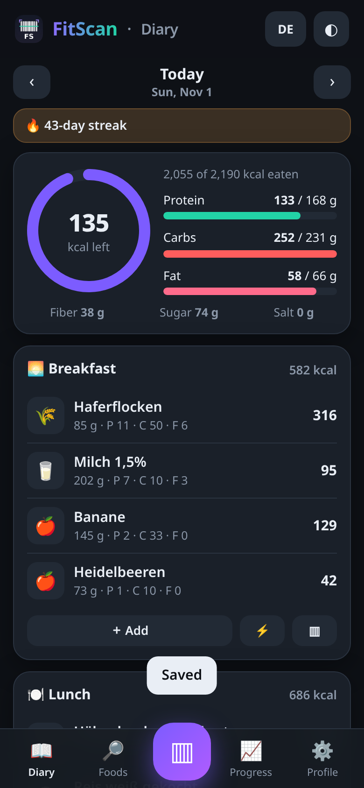
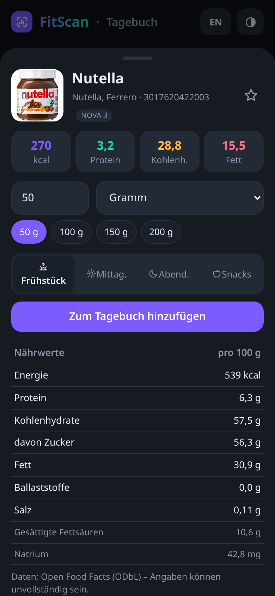
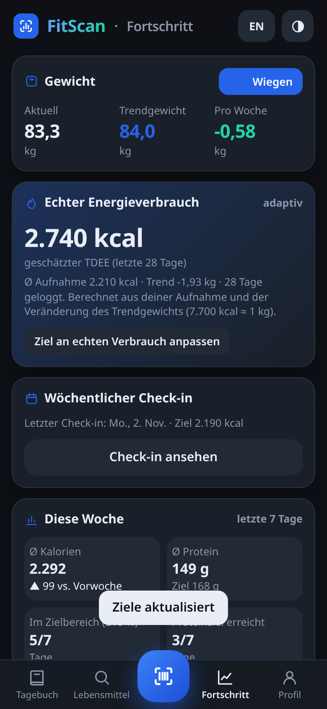
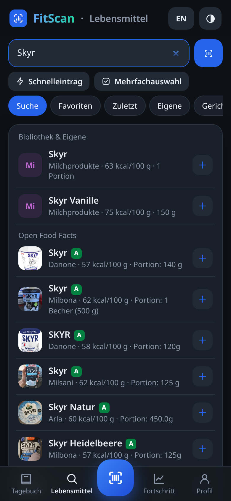

# FitScan

**Free calorie & macro tracker – unlimited barcode scans, no paywall.**

FitScan is an installable web app (PWA) for tracking calories, macros and body weight. No account, no server, no subscription – all data stays on your device.

👉 **Live:** https://corneliuskauffmann.github.io/fitscan/

| Diary | Barcode scan | Weight trend | Food search |
|---|---|---|---|
|  |  |  |  |

## Features
- **Guided onboarding:** goal, body data, activity and pace with a live calorie & macro preview
- **Weekly check-in (MacroFactor-style):** recalculates your expenditure from intake and trend weight and suggests new calorie/macro targets – accept or keep
- **Unlimited barcode scanning** (EAN/UPC/QR) via camera (native `BarcodeDetector`, bundled ZXing fallback), photo or manual entry. **Continuous scan mode** adds products directly; beep + vibration, torch when supported; **scan history** works offline
- **Fast logging:** quick add of kcal/macros, multi-select add, portion presets (½/1/2 servings, grams, "last time"), copy all of yesterday, per-meal scan button
- **Big food library:** Open Food Facts search with smarter ranking (exact/brand matches, German products, complete data, your recents & favorites), **500+ built-in foods offline**, custom foods, recipes
- **Nutri-Score & NOVA** badges, **micronutrients** (vitamins, minerals, sodium, saturated fat… where OFF has data) per product and per day
- **Diary** with calorie ring, macro bars, 🔥 logging streak, **water tracker** and **intermittent fasting timer**
- **Weight & body:** smoothed trend weight, weekly rate, adaptive TDEE, **body measurements** (waist, hips, chest, arm, thigh, neck, body fat %)
- **Insights:** weekly averages vs. last week, days on target (±10 %), protein goal hits
- **Charts:** weight + trend, calories vs. goal, macros, protein, weekly averages, body measurements, water, expenditure over time – 7D/30D/90D/1Y/All
- **Backup** (JSON import/export), CSV export (diary; weight + water + measurements), delete all data
- **German & English UI** (auto-detected, toggle in header), dark & light mode, works offline – no account, no paywall, no tracking

## Run locally
Any static server works, e.g. `python3 -m http.server 8000` → http://localhost:8000. Camera scanning requires HTTPS or localhost.

## Deploy
Hosted on GitHub Pages (Settings → Pages → Deploy from branch `main`, folder `/ (root)`). All paths are relative, so it works under `/fitscan/`.

## Credits & license
Product data © Open Food Facts contributors (ODbL). Bundled: Chart.js (MIT), ZXing-js (Apache-2.0). Basic food values are approximations based on public-domain USDA data.
FitScan is released under the MIT License.
